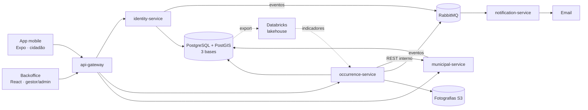

# Sinaliza

Plataforma para reportar e acompanhar ocorrências no espaço público do concelho de **Barcelos**:
buracos na estrada, iluminação avariada, lixo, mobiliário urbano danificado. O cidadão reporta na
app com fotografia e localização; a Câmara analisa, encaminha e resolve no backoffice; o cidadão
recebe um email a cada mudança de estado.

Projeto académico do Mestrado em Engenharia Informática do IPCA (DIA, AIS e BDA), de Rodrigo
Machado.



- **4 microserviços NestJS** com base de dados própria e um **API Gateway** como entrada única
  (JWT RS256, RBAC, CORS, _rate limit_, Swagger agregado).
- **RabbitMQ** com tentativas, _dead-letter queue_ e consumidor idempotente para os emails.
- **PostGIS** para validar que cada ocorrência está dentro do limite real de Barcelos (OSM).
- **Databricks** (Delta, medalhão bronze/silver/gold) como fonte opcional do dashboard.
- **Cloud** com Caddy e HTTPS automático.

Mais detalhe em [`docs/ARQUITETURA.md`](docs/ARQUITETURA.md) (diagramas, eventos, modelo de dados,
máquina de estados) e nas decisões em [`docs/DECISOES.md`](docs/DECISOES.md).

## Requisitos

- **Docker** com Compose 2.24 ou mais recente (Docker Desktop no Windows/macOS);
- **Node.js 24** e **pnpm 12** (`corepack enable`), para o _seed_, os testes e a app mobile;
- **Expo Go** no telemóvel (Android 10+ ou iOS 16+), para a app;
- opcional: [uv](https://docs.astral.sh/uv/) e uma conta Databricks Free Edition, para o
  `analytics/`.

## Arrancar em 3 comandos

```bash
cp .env.example .env && sh scripts/gerar-chaves.sh   # configuração e chaves do JWT
docker compose up -d --build --wait                  # tudo: infraestrutura, serviços, gateway, backoffice
pnpm install && pnpm seed                            # contas e 45 ocorrências de demonstração
```

No `.env`, mude as palavras-passe antes de expor a máquina a uma rede. Para confirmar que tudo
funciona: `sh scripts/verificar.sh --sem-build` (testes de requisitos contra a stack, com uma
tabela ✅/❌ de RF01 a RF20).

### URLs

| O quê                      | Endereço                                                  |
| -------------------------- | --------------------------------------------------------- |
| Backoffice                 | <http://localhost:8081>                                   |
| API (gateway)              | <http://localhost:8080/api>                               |
| Swagger (4 serviços)       | <http://localhost:8080/docs>                              |
| Estado dos serviços        | <http://localhost:8080/health>                            |
| RabbitMQ (filas, DLQ)      | <http://localhost:15672> · `RABBITMQ_USER`/`_PASSWORD`    |
| Armazenamento (consola S3) | <http://localhost:9001> · `S3_ACCESS_KEY`/`S3_SECRET_KEY` |
| Mailpit (emails enviados)  | <http://localhost:8025>                                   |

As portas mudam-se no `.env` (`GATEWAY_PORT`, `BACKOFFICE_PORT`, `S3_CONSOLE_PORT`, …).

### Contas de teste

Criadas por `pnpm seed` (só para demonstração; numa máquina pública mude-as, ver
[`docs/DEPLOY.md`](docs/DEPLOY.md)):

| Perfil        | Email                      | Palavra-passe | Onde entra |
| ------------- | -------------------------- | ------------- | ---------- |
| Administrador | `admin@sinaliza.pt`        | `Admin12345`  | backoffice |
| Gestor        | `gestor@sinaliza.pt`       | `Gestor12345` | backoffice |
| Cidadã        | `maria.fernandes@email.pt` | `Cidada12345` | app mobile |

Os outros cidadãos de demonstração usam endereços `example.com` e existem só como autores das
ocorrências.

## App no telemóvel (Expo Go)

```bash
cp apps/mobile/.env.example apps/mobile/.env
# EXPO_PUBLIC_API_URL=http://<IP do computador na rede local>:8080/api
pnpm --filter mobile start
```

Leia o QR code com o Expo Go (Android) ou com a câmara (iOS). O telemóvel e o computador têm de
estar na mesma rede e a _firewall_ tem de aceitar a porta 8080; para as fotografias, ponha também
`S3_PUBLIC_ENDPOINT=http://<IP>:9000` no `.env` da raiz e recrie o `occurrence-service`. Com a
stack na cloud basta `EXPO_PUBLIC_API_URL=https://api.<domínio>/api`. Detalhes em
[`apps/mobile/README.md`](apps/mobile/README.md).

## Desenvolvimento

```bash
pnpm lint && pnpm typecheck && pnpm test     # todos os pacotes
pnpm --filter backoffice dev                 # backoffice com recarregamento em :5173
pnpm test:system                             # testes de requisitos (stack a correr)
pnpm --filter @sinaliza/system-tests cleanup # apaga restos de testes interrompidos
sh scripts/backup-postgres.sh                # pg_dump das três bases para backups/
```

A lista completa de comandos está no [`CLAUDE.md`](CLAUDE.md). O lakehouse tem o seu guia em
[`analytics/README.md`](analytics/README.md) e a instalação na cloud em
[`docs/DEPLOY.md`](docs/DEPLOY.md).

## Estrutura

```
apps/
  mobile/                app Expo do cidadão
  backoffice/            React + Vite, servido por nginx
services/
  api-gateway/           entrada única: rotas, JWT, RBAC, CORS, rate limit, Swagger
  identity-service/      contas, autenticação, perfil, gestores        (identity_db)
  occurrence-service/    ocorrências, estados, fotografias, mapa, KPIs (occurrence_db)
  municipal-service/     categorias e limite do concelho               (municipal_db)
  notification-service/  emails a partir dos eventos (sem BD)
packages/
  shared/                tipos, estados, máquina de estados, contratos de eventos
  service-kit/           base NestJS comum (erros, auth, eventos, Swagger, config)
  config/                ESLint, TypeScript e Prettier partilhados
analytics/               gerador, export Parquet, notebooks e job Databricks
infra/                   init do PostgreSQL, limite de Barcelos, Caddyfile, chaves
scripts/                 gerar-chaves.sh, verificar.sh, backup-postgres.sh
tests/system/            testes de requisitos contra a stack real
docs/                    ARQUITETURA, DEPLOY, DECISOES, PROGRESSO, ESPECIFICACAO, api/ (OpenAPI)
docker-compose.yml       stack local
docker-compose.cloud.yml override para a cloud (Caddy + HTTPS)
```

## Rastreabilidade

### Requisitos funcionais

Os ecrãs da app estão em `apps/mobile/src/app/`; os do backoffice em `apps/backoffice/src/pages/`.
Os endpoints são do gateway (prefixo `/api`).

| Requisito                                 | Serviço                             | Endpoint                                                              | Ecrã                                                             |
| ----------------------------------------- | ----------------------------------- | --------------------------------------------------------------------- | ---------------------------------------------------------------- |
| RF01 Registo e autenticação               | identity                            | `POST /auth/register`, `/auth/login`, `/auth/refresh`, `/auth/logout` | app `(auth)/criar-conta`, `(auth)/login`; backoffice `LoginPage` |
| RF02 Perfis e permissões (RBAC)           | gateway + todos                     | lista de rotas com perfis (`routing/routes.ts`) e _guards_            | menus por perfil                                                 |
| RF03 Registar ocorrência                  | occurrence                          | `POST /photos`, `POST /occurrences`                                   | app `reportar/` (fotografia → categoria → localização → rever)   |
| RF04 As minhas ocorrências                | occurrence                          | `GET /occurrences/mine`                                               | app `(tabs)/minhas`                                              |
| RF05 Email a cada mudança de estado       | occurrence → notification           | evento `occurrence.status_changed`                                    | email                                                            |
| RF06 Validar/rejeitar com fundamentação   | occurrence                          | `POST /occurrences/:id/status`                                        | backoffice `OccurrenceDetailPage`                                |
| RF07 Alterar categoria                    | occurrence + municipal              | `PATCH /occurrences/:id/category`                                     | backoffice `OccurrenceDetailPage`                                |
| RF08 Ciclo de vida                        | shared + occurrence                 | máquina de estados (`packages/shared/src/state-machine.ts`)           | ações permitidas no detalhe                                      |
| RF09 Duplicada → original                 | occurrence                          | `POST /occurrences/:id/duplicate`                                     | backoffice `OccurrenceDetailPage`                                |
| RF10 Admin gere categorias e gestores     | municipal + identity                | `/categories`, `/users/gestores`, `/users/:id/(de)activate`           | backoffice `CategoriesPage`, `ManagersPage`                      |
| RF11 Mapas e geolocalização               | occurrence (Nominatim)              | `POST /locations/validate`, `GET /map/occurrences`                    | app `reportar/localizacao`, `(tabs)/mapa`; backoffice `MapPage`  |
| RF12 Validar dentro de Barcelos           | occurrence + municipal              | PostGIS `ST_Contains` em `/locations/validate` e `/occurrences`       | app `reportar/localizacao`                                       |
| RF13 Recuperar palavra-passe              | identity → notification             | `POST /auth/forgot-password`, `/auth/reset-password`                  | app `(auth)/recuperar`; backoffice `PasswordPages`               |
| RF14 Detalhe e histórico                  | occurrence                          | `GET /occurrences/:id`                                                | app `(tabs)/minhas/[id]`; backoffice `OccurrenceDetailPage`      |
| RF15 Mapa público sem autor               | occurrence                          | `GET /map/occurrences`, `/map/occurrences/:id`                        | app `(tabs)/mapa`                                                |
| RF16 Pesquisa e filtros                   | occurrence                          | `GET /occurrences?status=&category=&q=&from=&to=`                     | backoffice `OccurrencesPage`                                     |
| RF17 Dashboard                            | occurrence (Postgres ou Databricks) | `GET /stats/dashboard`                                                | backoffice `DashboardPage`                                       |
| RF18 Perfil                               | identity                            | `GET`/`PATCH /users/me`, `POST /users/me/password`                    | app `(tabs)/perfil`; backoffice `ProfilePage`                    |
| RF19 Rever antes de submeter + referência | occurrence                          | `POST /occurrences` → `SIN-AAAA-NNNNN`                                | app `reportar/rever`, `reportar/enviada`                         |
| RF20 Anular enquanto Recebida             | occurrence                          | `POST /occurrences/:id/cancel`                                        | app `(tabs)/minhas/[id]`                                         |

### Requisitos não funcionais

| Requisito                                | Onde                                                                                                 |
| ---------------------------------------- | ---------------------------------------------------------------------------------------------------- |
| Microserviços com BD própria             | `services/*`, um `Dockerfile` cada; `infra/postgres/init` cria 3 bases e 3 utilizadores (RNF07)      |
| Gateway como entrada única               | `services/api-gateway`; os serviços não publicam portas                                              |
| REST síncrono + AMQP assíncrono          | `/internal/*` occurrence → municipal; `sinaliza.events`, DLQ e tentativas (`docs/ARQUITETURA.md` §4) |
| OpenAPI (RNF04)                          | `/docs` em cada serviço e agregado no gateway; `docs/api/*.json`                                     |
| Segurança                                | JWT RS256, argon2, _refresh_ rotativo, `ValidationPipe`, _rate limit_, `helmet`, CSP                 |
| HTTPS (RNF06) e cloud (RNF10)            | `docker-compose.cloud.yml`, `infra/caddy/Caddyfile`, `docs/DEPLOY.md`                                |
| Contentores com _healthchecks_ (RNF09)   | `docker-compose.yml` (`depends_on: service_healthy`)                                                 |
| Fotografias por URL pré-assinado (RNF11) | `occurrence-service` `integrations/storage.service.ts` (15 min)                                      |
| Paginação e erros consistentes (RNF19)   | `{ items, page, pageSize, total }`; `{ statusCode, error, message, details?, requestId }`            |
| Fotografias ≤ 2 MB (RNF20)               | compressão na app (`expo-image-manipulator`) e reprocessamento no serviço                            |
| Privacidade / RGPD (RNF24)               | mapa sem autor; EXIF removido; o lake não recebe dados pessoais (D35)                                |
| Sessão de 30 min (RNF25)                 | backoffice `INACTIVITY_LIMIT_MS`, com aviso 1 min antes                                              |
| Acessibilidade, PT-PT, ecrãs 360–430 dp  | componentes com `aria-*`/`accessibilityLabel`, alvos ≥ 48 dp, textos em PT-PT                        |

## Licença e dados

Código para fins académicos. O limite do concelho e os mosaicos dos mapas são © colaboradores do
[OpenStreetMap](https://www.openstreetmap.org/copyright) (ODbL).
