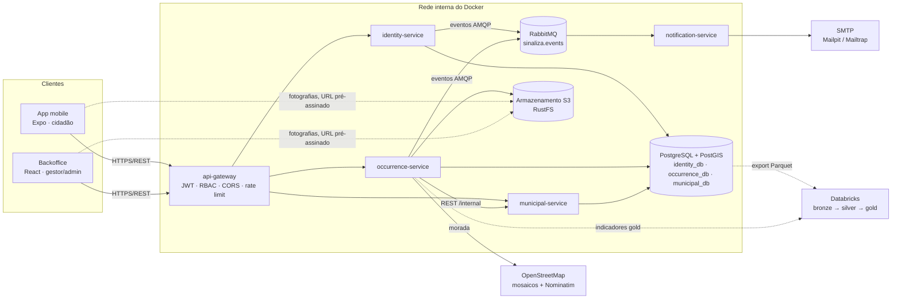
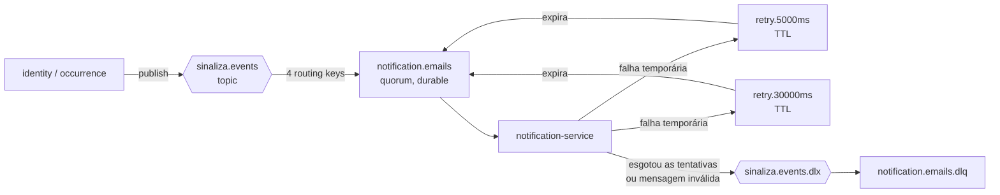
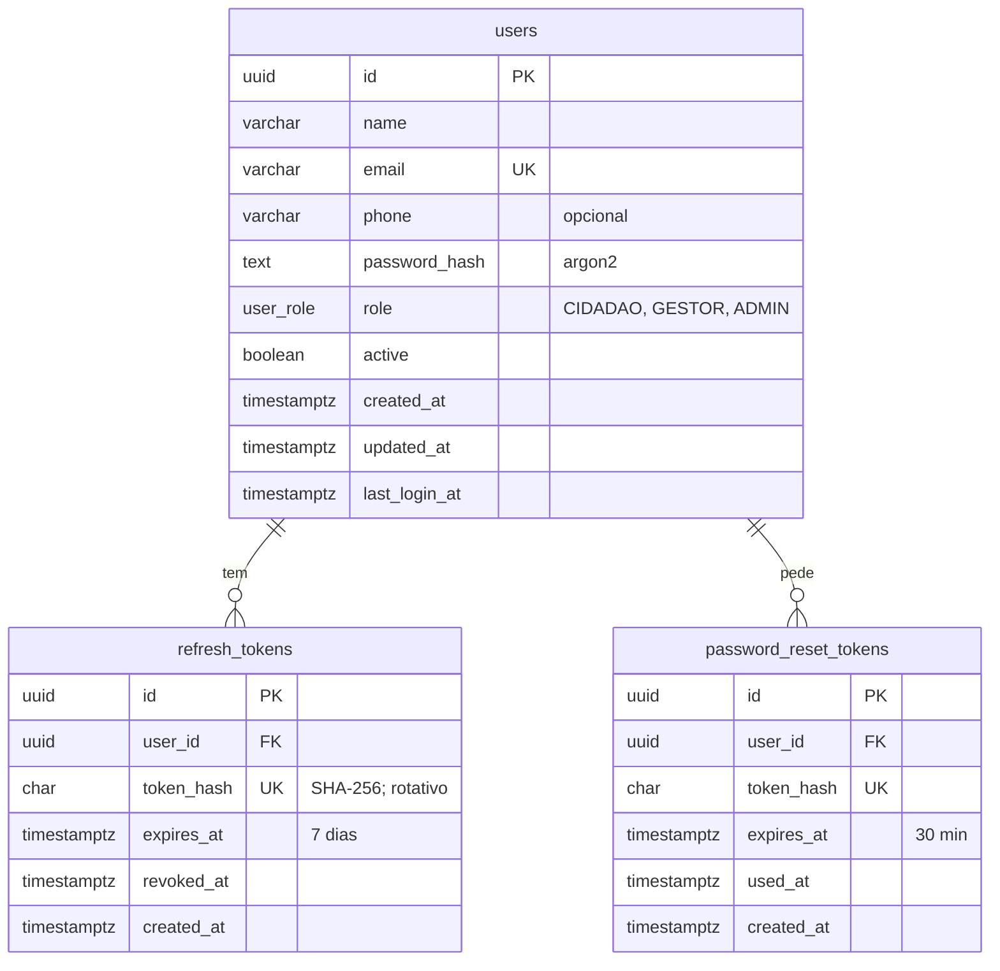
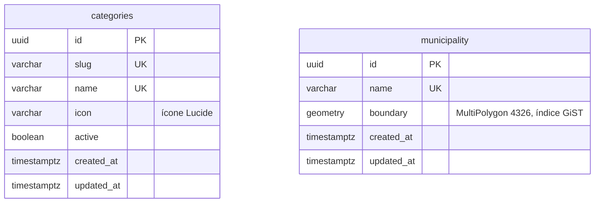
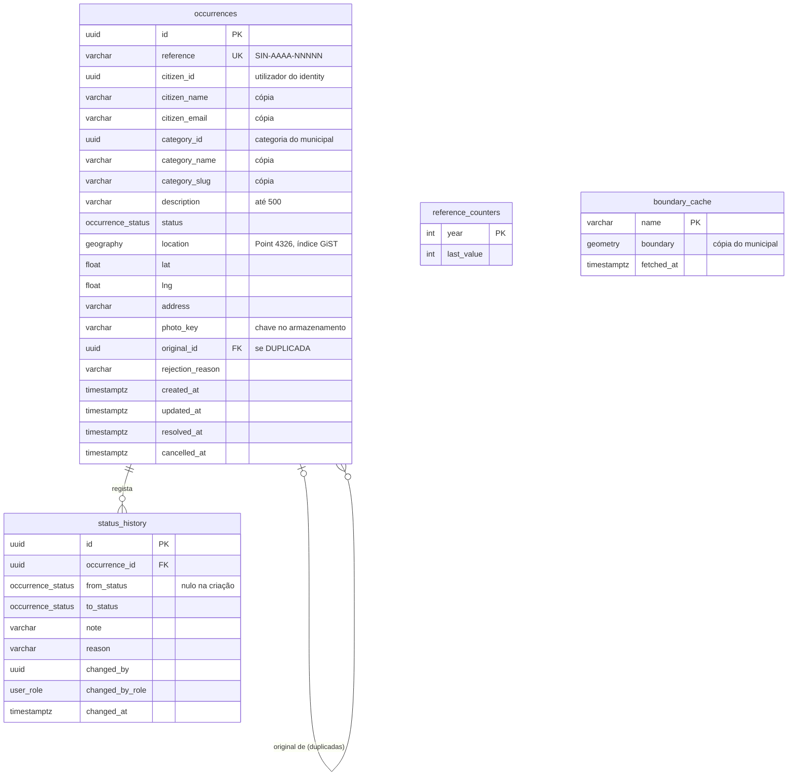
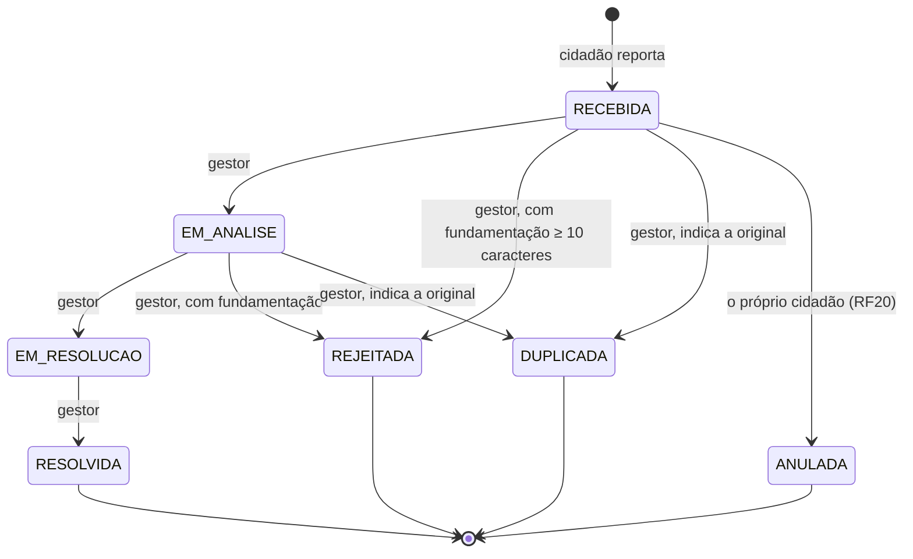
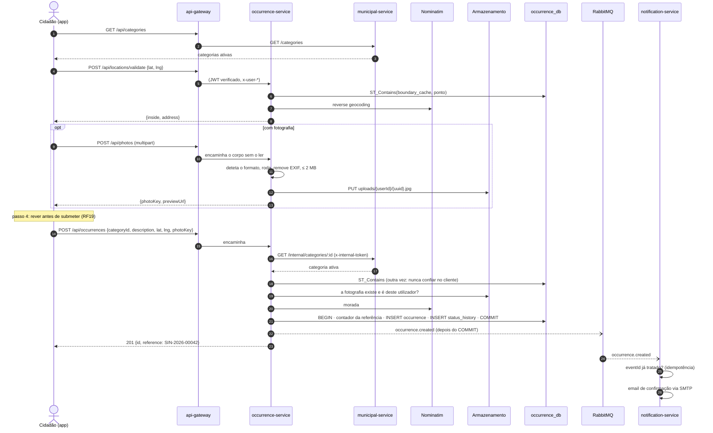

# Sinaliza · Arquitetura

Como o sistema está organizado, como as peças falam entre si e porquê. As decisões detalhadas
(com as alternativas rejeitadas) estão em [`DECISOES.md`](DECISOES.md), referidas aqui como `Dnn`.

## 1. Visão geral



| Componente             | Responsabilidade                                                                                                            | Dados                          |
| ---------------------- | --------------------------------------------------------------------------------------------------------------------------- | ------------------------------ |
| `api-gateway`          | único ponto de entrada; lista explícita de rotas, JWT, RBAC, CORS, `helmet`, _rate limit_, `x-request-id`, Swagger agregado | —                              |
| `identity-service`     | registo, login, _refresh tokens_, recuperação de palavra-passe, perfil, gestão de gestores                                  | `identity_db`                  |
| `occurrence-service`   | ocorrências, máquina de estados, fotografias, validação geográfica, mapa público, dashboard                                 | `occurrence_db`, armazenamento |
| `municipal-service`    | categorias e limite do concelho (carregado de `infra/geo/barcelos.geojson`)                                                 | `municipal_db`                 |
| `notification-service` | consome eventos e envia emails, com tentativas e DLQ                                                                        | — (sem BD)                     |
| `backoffice`           | build estático servido por nginx, lê o endereço da API em `/config.js` (D31)                                                | —                              |
| `analytics/`           | gerador sintético, export para Parquet, notebooks e job no Databricks                                                       | lakehouse `sinaliza`           |

Todos os serviços são NestJS em TypeScript e partilham dois pacotes: `@sinaliza/shared` (tipos,
estados, máquina de estados, contratos de eventos) e `@sinaliza/service-kit` (erros JSON em PT-PT,
autenticação JWT/RBAC, publicação de eventos, Swagger, configuração; D08).

## 2. Decisões principais

| Tema                   | Decisão                                                                                                                   |
| ---------------------- | ------------------------------------------------------------------------------------------------------------------------- |
| Isolamento de dados    | um contentor PostGIS, três bases e três utilizadores; cada serviço só vê a sua (RNF07)                                    |
| Entrada única          | o gateway só encaminha rotas de uma lista revista, comparada por teste com os specs OpenAPI (D24)                         |
| Identidade             | JWT RS256 assinado pelo identity; gateway e serviços verificam com a chave pública (defesa em profundidade; D23, D25)     |
| Chamadas internas      | `/internal/*` com `x-internal-token`, nunca encaminhadas pelo gateway (D13)                                               |
| Eventos                | publicados depois da transação, sem bloquear o pedido (D10); consumidor idempotente, entrega «pelo menos uma vez» (D22)   |
| Estados                | máquina de estados pura em `@sinaliza/shared`, usada pelos serviços e pelas duas interfaces (D04)                         |
| Geografia              | limite real de Barcelos do OSM (D14); cópia local no occurrence-service para `ST_Contains` mesmo com o municipal em baixo |
| Fotografias            | reprocessadas (EXIF removido, ≤ 2 MB), chave por utilizador, lidas por URL pré-assinado de 15 min (D19)                   |
| Dashboard              | vistas SQL na base operacional por omissão (D20) ou tabelas gold do Databricks (D36, D38)                                 |
| Dados pessoais no lake | o export nunca envia nome, email nem descrição; o cidadão é um UUID (D35)                                                 |
| Cloud                  | _override_ do compose com Caddy e HTTPS automático; só 80/443 abertos (D40, [`DEPLOY.md`](DEPLOY.md))                     |

## 3. Comunicação síncrona

- **Cliente → gateway:** REST sobre HTTPS na cloud (HTTP em local). O gateway apaga os cabeçalhos
  de identidade que o cliente enviar, verifica o JWT e acrescenta `x-user-id`, `x-user-role`,
  `x-user-email`, `x-user-name`, `x-request-id` e um `X-Forwarded-For` com um só IP (D25).
- **Gateway → serviços:** encaminhamento sem ler o corpo (D26). Cada serviço volta a verificar o
  JWT e o perfil.
- **occurrence → municipal:** `GET /internal/categories/:id` em cada nova ocorrência ou mudança de
  categoria (a categoria tem de existir e estar ativa) e `GET /internal/municipality` para o
  limite, guardado na tabela `boundary_cache` e renovado periodicamente. Sem resposta em 5 s → 503;
  erro inesperado → 502; categoria inexistente ou desativada → 422 (D18).
- **occurrence → Nominatim:** morada aproximada a partir das coordenadas, com `User-Agent` próprio
  e no máximo um pedido por segundo; se falhar, a morada fica com as coordenadas.

Os erros têm sempre o mesmo formato JSON:

```json
{ "statusCode": 422, "error": "Unprocessable Entity", "message": "…", "requestId": "…" }
```

## 4. Eventos (AMQP)

_Exchange_ `sinaliza.events` do tipo _topic_; a _routing key_ é o tipo do evento. Todos os eventos
usam o mesmo envelope (`packages/shared/src/events.ts`):

```ts
interface EventEnvelope<T> {
  eventId: string; // UUID, chave de idempotência
  type: T; // 'occurrence.created', ...
  occurredAt: string; // ISO 8601
  version: 1;
  payload: EventPayloads[T];
}
```

| Evento                          | Publicado por | Quando                        | Payload (principais campos)                                                                       | Email enviado                |
| ------------------------------- | ------------- | ----------------------------- | ------------------------------------------------------------------------------------------------- | ---------------------------- |
| `user.registered`               | identity      | registo de um cidadão         | `userId`, `name`, `email`                                                                         | boas-vindas                  |
| `user.password_reset_requested` | identity      | pedido de recuperação (RF13)  | `userId`, `name`, `email`, `resetUrl`, `expiresAt`                                                | link para redefinir (30 min) |
| `occurrence.created`            | occurrence    | nova ocorrência               | `id`, `reference`, `citizen`, `category`, `address`, `createdAt`                                  | confirmação com a referência |
| `occurrence.status_changed`     | occurrence    | cada mudança de estado (RF05) | `id`, `reference`, `citizen`, `from`, `to`, `note?`, `reason?`, `originalReference?`, `changedAt` | novo estado e fundamentação  |



- **Tentativas com _backoff_:** uma fila de atraso por tentativa (5 s, depois 30 s; configurável em
  `NOTIFICATION_RETRY_DELAYS_MS`). Depois disso a mensagem vai para a DLQ, onde fica visível na
  consola do RabbitMQ (D21).
- **Idempotência:** o consumidor guarda os `eventId` tratados (LRU de 10 000) e só confirma a
  mensagem depois de o SMTP aceitar o email (D22).
- **Versão:** `version: 1` em todos os eventos; uma alteração incompatível cria a versão 2 e o
  consumidor passa a aceitar as duas durante a transição.

## 5. Modelo de dados

Cada serviço tem a sua base; não há chaves estrangeiras entre bases. O occurrence-service guarda
uma cópia do nome e do email do cidadão e do nome da categoria no momento do registo, para não
depender dos outros serviços ao listar ou ao enviar eventos.

### `identity_db`



### `municipal_db`



### `occurrence_db`



A referência `SIN-AAAA-NNNNN` sai de `reference_counters` na mesma transação que cria a
ocorrência (`INSERT … ON CONFLICT DO UPDATE … RETURNING`), por isso nunca se repete. Os
indicadores do dashboard em modo Postgres são vistas SQL sobre estas duas tabelas (D20).

## 6. Máquina de estados (RF08)



- As regras estão em `packages/shared/src/state-machine.ts` e são as mesmas no serviço, no
  backoffice e na app (que só mostram as ações permitidas).
- Erros: transição inexistente → 409; perfil errado → 403; falta a fundamentação ou a original → 400.
- A original de uma duplicada tem de existir, ser outra ocorrência e não estar `DUPLICADA` nem
  `ANULADA`.
- Cada transição grava uma linha em `status_history` e publica `occurrence.status_changed`.

## 7. Sequência «reportar ocorrência» (RF03, RF12, RF19)



## 8. Segurança

- **Autenticação:** _access token_ JWT RS256 de 15 min; _refresh token_ de 7 dias, rotativo, guardado
  com _hash_ e revogado no logout. Palavras-passe com argon2 (mínimo 8, letras e números).
- **Autorização:** RBAC por rota no gateway e outra vez em cada serviço; um cidadão só vê as suas
  ocorrências e o mapa público nunca mostra o autor (RF15).
- **Entrada:** `ValidationPipe` com `whitelist` e `forbidNonWhitelisted`; limites de tamanho nas
  fotografias; _rate limit_ global e mais apertado no login, registo e recuperação.
- **Transporte:** HTTPS com HSTS no Caddy (cloud); CSP, `nosniff` e `frame-ancestors 'none'` no
  backoffice; `helmet` no gateway.
- **Segredos:** só no `.env` (nunca no Git); chave privada do JWT só no identity-service.
- **Sessões:** o backoffice termina a sessão após 30 min sem atividade (RNF25).

## 9. Analytics

O lakehouse está descrito em [`analytics/README.md`](../analytics/README.md): export incremental
para Parquet num volume do Unity Catalog, Auto Loader para a bronze, MERGE com regras de qualidade
e quarentena na silver, indicadores diários e hexágonos H3 na gold. O `occurrence-service` lê a
gold pela SQL Statement Execution API quando `ANALYTICS_SOURCE=databricks` (D35–D39).

## 10. Implantação

Local: `docker compose up -d --build --wait` arranca tudo com _healthchecks_ e
`depends_on: service_healthy`. Cloud: o mesmo compose com o _override_ `docker-compose.cloud.yml`
(Caddy, HTTPS automático, consolas só por túnel SSH) — passo a passo em [`DEPLOY.md`](DEPLOY.md).
